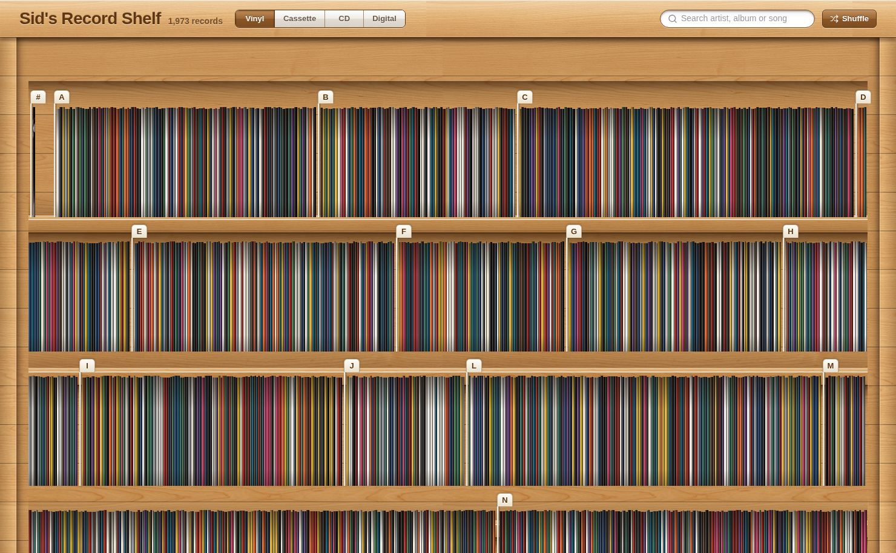
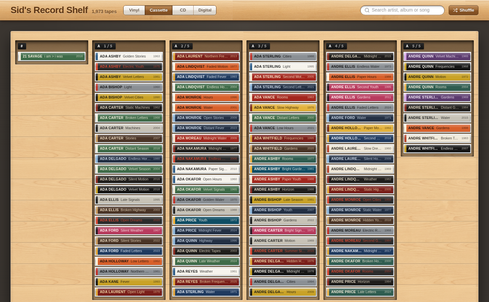
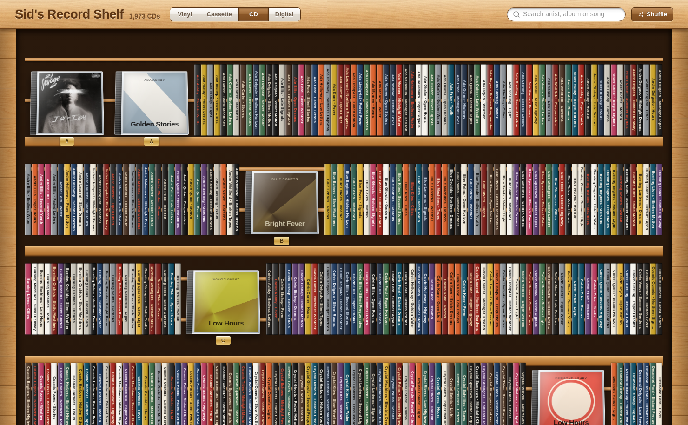
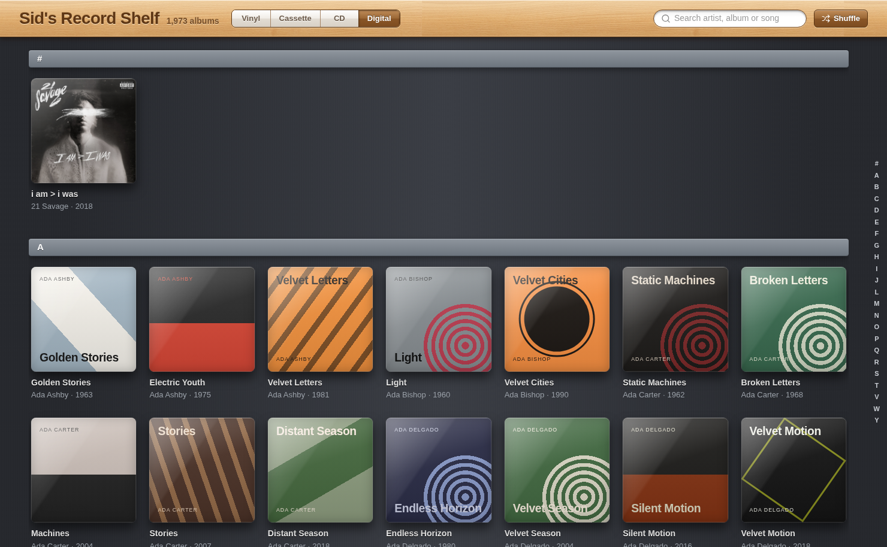
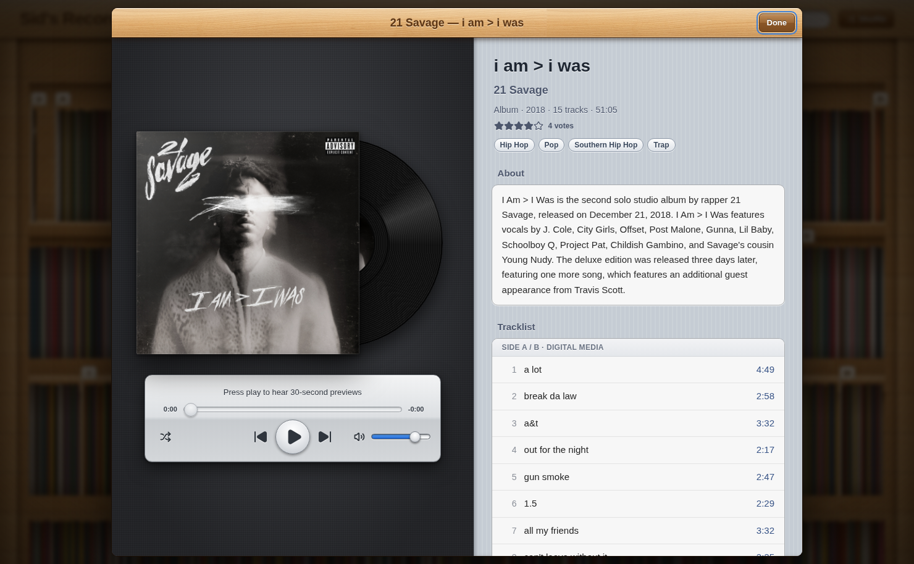
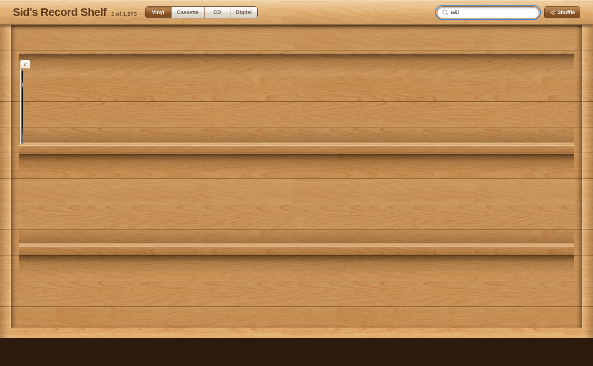
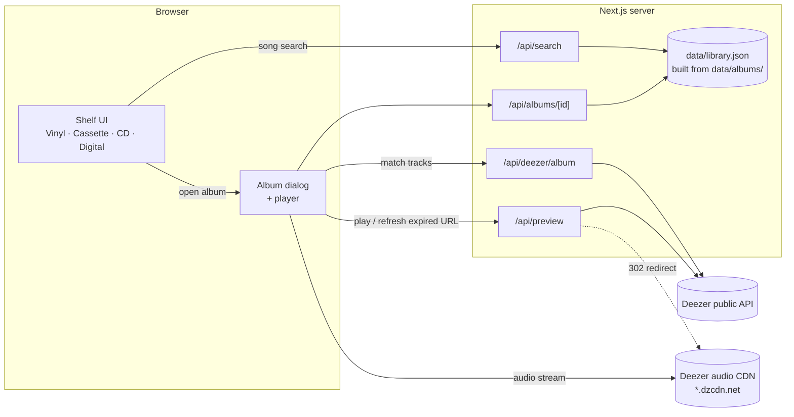

<div align="center">

# Sid's Record Shelf

**A skeuomorphic, iOS 6–inspired music library for browsing a 1,973-album collection — as vinyl, cassettes, CDs, or a digital grid — with 30-second song previews from Deezer.**




</div>

---

## Contents

- [What it does](#what-it-does)
- [Screenshots](#screenshots)
- [Quick start](#quick-start)
- [How it works](#how-it-works)
- [Project structure](#project-structure)
- [Adding your own albums](#adding-your-own-albums)
- [Documentation](#documentation)
- [Contributing](#contributing)

## What it does

Sid's Record Shelf turns a music collection into a wooden bookcase you can browse like a real one.

| Feature | Description |
| --- | --- |
| **Four shelf formats** | Switch between **Vinyl**, **Cassette**, **CD**, and **Digital** with an iOS 6–style segmented control. Each format has its own spines, cases, and hover physics. |
| **A–Z sections** | Albums are sorted by artist, then release date, and grouped under lettered tabs. |
| **Pull-out hover** | Hover a spine to pull the record, tape, or case off the shelf and tilt it toward you. Items near a shelf edge stay inside the bookcase, and a held item stays put while you move onto it to click. |
| **Album detail view** | Click any item to open a dialog with cover art, the matching format stage (a record sliding from its sleeve, a cassette, a CD peeking from its jewel case), metadata, genres, ratings, and the full tracklist. |
| **30-second previews** | Tracks are matched to Deezer on the server and played through a skeuomorphic player with seek, volume, shuffle, and next/previous. |
| **Clear preview states** | A loader shows while previews are fetched from Deezer. Songs without a preview are marked **No preview** and skipped automatically. |
| **Search** | Search by **artist, album, or song name**. A song match shows the album that contains it on the shelf. |
| **Shuffle** | Open a random album from the collection. |

## Screenshots

| Cassette | CD |
| :---: | :---: |
|  |  |
| **Digital** | **Album detail** |
|  |  |

<details>
<summary><strong>Song search</strong></summary>

Searching for a song (here, <code>a&amp;t</code>) narrows the shelf to the album that contains it.



</details>

## Quick start

### Prerequisites

- **Node.js 20.9+** (required by Next.js 16)
- **pnpm** (the repo pins its version in `package.json` → `packageManager`; enable it with `corepack enable`)

### Run locally

```bash
git clone https://github.com/sidhyatikku/record-company.git
cd record-company
pnpm install
pnpm dev
```

Open [http://localhost:3000](http://localhost:3000).

### Scripts

| Command | What it does |
| --- | --- |
| `pnpm dev` | Start the development server (Turbopack) |
| `pnpm build` | Create a production build |
| `pnpm start` | Serve the production build |

### Environment variables

**None are required.** Deezer's public API needs no key, and all album data ships with the repo.

### Deploy

The app is a standard Next.js project, so it deploys to [Vercel](https://vercel.com/new) with no extra configuration.

## How it works



1. **Collection data.** `pnpm build:library` reads the per-artist folders in `data/albums/`, writes the manifest `data/library.json` and web-sized covers in `public/covers/`. `lib/albums.ts` loads that manifest at runtime.
2. **Shelf rendering.** `components/shelf/` renders the bookcase for the selected format, grouped into A–Z sections.
3. **Track matching.** When an album opens, `/api/deezer/album` finds the album on Deezer and returns each track's preview URL, or `null` when Deezer has none.
4. **Playback.** `use-album-player.ts` drives a single `<audio>` element. If a signed preview URL has expired, it asks `/api/preview` for a fresh one. Tracks with no preview are marked unavailable and skipped.

See **[docs/ARCHITECTURE.md](docs/ARCHITECTURE.md)** for the full breakdown.

## Project structure

```text
.
├── app/
│   ├── api/
│   │   ├── albums/[id]/route.ts   # Full album record by id
│   │   ├── deezer/album/route.ts  # Match an album on Deezer, list track previews
│   │   ├── preview/route.ts       # Resolve one track's preview → 302 to Deezer CDN
│   │   └── search/route.ts        # Song-name search across tracklists
│   ├── globals.css                # Tailwind v4 + design tokens
│   ├── shelf.css                  # Bookcase, vinyl, dialog, player styles
│   ├── formats.css                # Cassette, CD, digital styles
│   ├── layout.tsx
│   └── page.tsx
├── components/
│   ├── shelf/                     # All shelf, dialog, and player components
│   └── ui/                        # shadcn/ui primitives
├── data/
│   ├── albums/
│   │   ├── Album Info/<Artist>/   # Album metadata (JSON), one folder per artist
│   │   └── Album Art/<Artist>/    # Original artwork (Git LFS)
│   └── library.json               # Generated manifest (pnpm build:library)
├── scripts/
│   └── build-library.mjs          # Builds the manifest + WebP covers
├── lib/
│   ├── albums.ts                  # Collection builder, sorting, search
│   └── types.ts                   # Shared types
├── public/
│   ├── covers/<Artist>/           # Generated WebP artwork
│   └── textures/wood.png          # Shelf texture
└── docs/                          # Project documentation
```

## Adding your own albums

1. Save the album's metadata as `data/albums/Album Info/<Artist>/<Album title>.json`.
2. Save its artwork with the same name under `data/albums/Album Art/<Artist>/`.
3. Run `pnpm build:library`.

The schema and a full walkthrough are in **[docs/ADDING_ALBUMS.md](docs/ADDING_ALBUMS.md)**.

## Documentation

| Doc | Covers |
| --- | --- |
| [Architecture](docs/ARCHITECTURE.md) | Data flow, components, player state machine, hover mechanics |
| [API reference](docs/API.md) | Every route handler, its parameters, and responses |
| [Adding albums](docs/ADDING_ALBUMS.md) | Album JSON schema and how to register new records |
| [Contributing](CONTRIBUTING.md) | Branching, commits, and pull request checklist |
| [Changelog](CHANGELOG.md) | Notable changes |

## Contributing

Contributions are welcome. Read **[CONTRIBUTING.md](CONTRIBUTING.md)** before opening a pull request.

## Acknowledgements

- Song previews come from the [Deezer API](https://developers.deezer.com/api). Previews are 30-second clips; availability depends on Deezer's licensing per track and region.
- Album metadata comes from [MusicBrainz](https://musicbrainz.org/) and the sources linked in each album file.
- Visual direction is inspired by the wooden bookshelves of iOS 6.

---

<div align="center">
<sub>Built with Next.js · Made for record collectors</sub>
</div>
