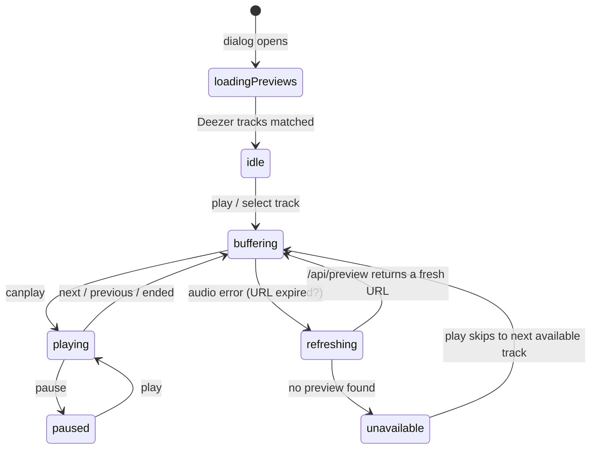

# Architecture

This document explains how Sid's Record Shelf is put together: where the data comes from, how the shelf renders, and how song previews are found and played.

## Stack

| Layer | Choice |
| --- | --- |
| Framework | Next.js 16 (App Router, Turbopack) |
| UI | React 19, Tailwind CSS v4, hand-written skeuomorphic CSS, shadcn/ui primitives |
| Icons | lucide-react |
| Data fetching | SWR on the client, Route Handlers on the server |
| Audio | A single native `<audio>` element |
| Previews | Deezer public API (no key required) |
| Analytics | `@vercel/analytics` |

## Data model

### The collection

`lib/albums.ts` exports a collection of `COLLECTION_SIZE` (1,973) albums built from two sources:

1. **Real albums**, registered in `data/real-albums.ts`. Each one pairs a metadata JSON from `data/albums/` with an optional cover in `public/covers/`.
2. **Placeholder albums** that fill every remaining slot. They are generated deterministically from word lists and a palette table, so the same slot always has the same artist, title, colors, and tracklist. Placeholders are flagged so the detail dialog shows a "still downloading" notice and the player says previews aren't available.

The collection is sorted by artist, then release date. Each album gets a `section` letter (`#` for names starting with a digit or symbol), and `groupBySection` in `components/shelf/views.ts` turns the sorted list into contiguous A–Z sections.

### Summary vs. full album

- **`AlbumSummary`** has just enough to draw a spine or cover: id, title, artist, palette, cover, section. The whole shelf uses summaries.
- **`Album`** is the full record: description, genres, rating, links, and tracklist. The dialog loads it on demand from `/api/albums/[id]`.

Keeping the shelf on summaries keeps the initial payload small even with nearly 2,000 items.

### Search

`searchSongs(q)` in `lib/albums.ts` normalizes the query and scans every tracklist. `/api/search` returns `{ id, song }` matches. The header merges them with the client-side artist and album filter, so a song hit shows its album on the shelf.

## Component map

```text
ShelfApp                     state: view, query, selected album
├── ShelfHeader              title, count, ViewToggle, search, shuffle
├── Bookcase                 vinyl shelf (RecordSpine × N, SectionDivider)
├── CassetteRack             cassette shelf
├── CdRack                   CD shelf
├── DigitalGallery           cover grid
└── AlbumDialog              <dialog>, loads the full album
    ├── FormatStage          vinyl / cassette / CD / digital stage art
    ├── PlayerControls       transport, seek, volume, status line
    └── AlbumDetails         metadata, genres, rating, tracklist
```

All of these live in `components/shelf/`. `use-album-player.ts` holds the playback logic and is shared by `PlayerControls` and `AlbumDetails`.

## Song previews

### 1. Matching an album on Deezer

When the dialog opens a real album, it requests:

```text
GET /api/deezer/album?artist=<artist>&title=<title>
```

The route searches Deezer for `artist:"…" album:"…"`, scores the candidates (exact normalized title, then matching artist, then `record_type === 'album'`, then track count), and fetches the winner's tracklist.

- The **album search** is cached for a day, because Deezer album ids never change.
- The **tracklist** is always fetched fresh, because preview URLs are signed and expire.
- Only `https://*.dzcdn.net` URLs are accepted as previews. Anything else becomes `null`.

The player then pairs each local track with a Deezer track by normalized title and position.

### 2. Playing a track

`use-album-player.ts` keeps one `<audio>` element and exposes `status`, `currentIndex`, `progress`, `volume`, `shuffle`, and per-track availability.



- **Loading.** While `/api/deezer/album` is in flight, the status line reads "Finding 30-second previews on Deezer…", the play button shows a spinner, and the tracklist header shows a loading banner.
- **Expired URLs.** If playback fails, the hook calls `/api/preview` once for that track. The route redirects (302) to a fresh CDN URL.
- **Unavailable tracks.** A track with no preview is dimmed, tagged **No preview**, and the player shows a notice instead of playing. Pressing play or next skips to the next track that has a preview.

## Shelf hover mechanics

Every format uses the same idea: a thin spine sits on the shelf, and on hover a 3D-transformed face swings out.

- **Edge awareness.** Lifted items are positioned so they stay inside the bookcase. In the CD rack, which swings cases sideways, each slot gets a `data-side` attribute from its position in the row, and the case opens toward the middle of the shelf.
- **Hover bridge.** A lifted item extends an invisible, flat hit area (`.cd-slot:hover::after` for CDs) over the swung-out face and the gap between it and the spine. Moving the cursor from the spine onto the face keeps the hover, so the item stays held and can be clicked. Without it, the pointer would cross neighboring spines and the item would drop back.
- **Reduced motion.** Transitions are short and respect `prefers-reduced-motion`.

## Styling

- `app/globals.css` holds Tailwind v4 setup and design tokens.
- `app/shelf.css` covers the bookcase, vinyl spines, the dialog, the player, and the tracklist.
- `app/formats.css` covers cassette, CD, and digital formats and their stages.
- The wood texture is `public/textures/wood.png`. Gloss, bevels, and shadows are CSS gradients and box-shadows, with no image sprites.

## Caching summary

| Resource | Where | Lifetime |
| --- | --- | --- |
| Deezer album search | Next.js data cache | 24 h |
| Deezer tracklist | not cached | — |
| `/api/preview` lookups | Next.js data cache | 30 min |
| `/api/preview` redirect | browser (`private`) | 15 min |
| `/api/search` responses | HTTP cache | 5 min, then stale-while-revalidate for 1 day |
| Full album records | SWR (client) | session |
